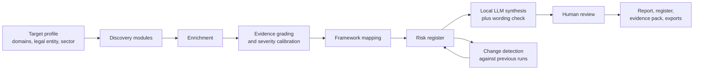

# Architecture

The platform runs as a pipeline. Each stage hands structured data to the next, and every finding carries its evidence with it from discovery through to the final report.

## Stages

### 1. Target profile
Each assessment starts with a profile: the domains in scope, the legal entity (one or more ABNs) and the sector. The sector decides which obligations get mapped. The platform remembers the profile for each domain so repeat assessments run the same way.

### 2. Discovery modules
Each module looks at one part of the external footprint, using public sources only.

| Area | What it looks for |
|---|---|
| Domains and hosts | Subdomains, hosting, passive DNS history |
| Edge and origin | CDN and web application firewall presence, and origin servers that can be reached directly, bypassing them |
| Email | SPF, DKIM and DMARC posture |
| Identity and cloud | Microsoft 365 and Entra ID tenant footprint |
| Web applications | Third-party scripts and services loaded by public pages, plus the privacy policy and its disclosures |
| Mobile apps | Published apps and the privacy labels declared in app stores |
| Code and packages | Public repositories and packages on GitHub, GitLab, Docker Hub, npm and PyPI that may be linked to the organisation |
| Brand and entity | Domains and brands linked to the organisation's ABNs |
| Reputation | Safe Browsing status |

### 3. Enrichment
Findings are enriched with exploitation context, including CISA Known Exploited Vulnerabilities (KEV) status, ransomware-use flags and EPSS scores. Attribution pivots help confirm or rule out whether an asset actually belongs to the organisation.

### 4. Evidence grading and severity calibration
Every finding is graded on its evidence and calibrated for severity. See [evidence-grading.md](evidence-grading.md).

### 5. Framework mapping
Findings are mapped to ISO/IEC 27001:2022 Annex A controls and to the obligations that apply to the sector, such as the Essential Eight, the Privacy Act (APPs), CPS 234 and SOCI.

### 6. Risk register
Each finding becomes a register entry: priority, evidence grade, control domain, suggested client owner and treatment. The register exports to Excel and CSV so it can be merged into an organisation's existing risk register.

### 7. Synthesis and wording check
A local model, run through Ollama so data stays on my machine, drafts the executive summary from the register. A wording check then flags overstated or alarmist phrasing, and anything that doesn't match the evidence grades.

### 8. Human review
I review every report before it goes out. Generated text is a draft, never a final answer.

### 9. Change detection
Each run is compared with the previous one. An item is only marked resolved, or a host only marked gone, if the module that produced it actually ran and was assessed. A check that didn't run is reported as *Not assessed*.
